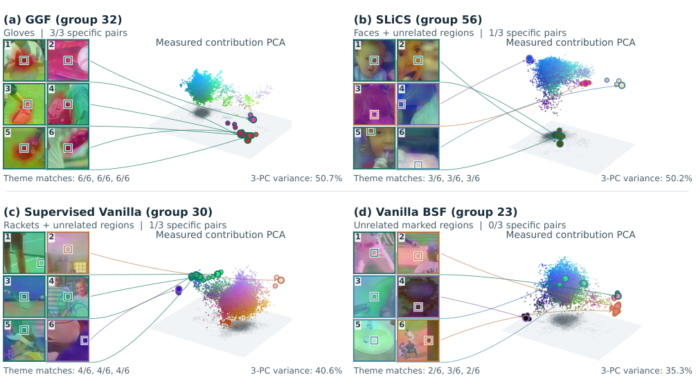

<p align="center">
  <a href="https://algoverseairesearch.org"> <strong>Algoverse AI Research</strong></a>
</p>

<h1 align="center">Guided Group Featurizers (GGF)</h1>
<p align="center"><strong>Improving Block-Sparse Featurizers with Object-Guided Learning</strong></p>
<p align="center"><a href="docs/PAPER.md">Paper</a> · <a href="#explore-the-demo">Interactive demo</a> · <a href="#reproduce-the-research">Research code</a></p>



> **Figure 2. Coherent and mixed responses in selected native groups.** Six reviewed images per method are linked to PCA projections of their decoded patch contributions. **Specific pairs** counts majority-confirmed shared meanings out of three fixed pairs. **Theme matches** gives each of three reviewers' matching-view counts out of six. **3-PC variance** is the reference variance retained by the first three principal components. Each method has its own fitted PCA basis. These selected seed-21 examples illustrate the seven-order aggregate study; they are not an exhaustive comparison.

## Demo video

https://github.com/user-attachments/assets/4ff30560-c541-476a-958d-e2451fd33d92

Original pair-by-pair judgments and marked patches, linked group geometry, and a live DINOv3 upload compared across all four methods. Recorded from the running app; live inference runs locally on a CPU. The upload uses a public COCO image.

GGF uses object guidance to organize block-sparse visual representations into groups with more semantically coherent responses and more concentrated object information. It retains the BSF architecture. The research compares matched 75-group methods across seven training orders, with three-context blinded GPT reviews, a separate Gemini check, and calibrated concentration and false-positive measurements.

## Explore the demo

The concept atlas compares GGF, SLiCS, supervised Vanilla BSF and Vanilla BSF. Start with all **900 original seed-21 pairs**, inspect the marked patches and frozen judgments, and follow each patch into its measured group geometry. Rotate the clouds, explore co-activation, or enable local inference for new images.

```sh
cd demo
npm ci
npm run dev
```

Open **http://127.0.0.1:5173**. Recorded exploration needs no API key, model download or paid service. See [demo setup](demo/README.md) for live inference and local asset requirements. The demo's interactive models are seed21; the benchmark panel separately reports the seven-order study. Group geometry uses actual decoded responses and frozen PCA axes. The optional UMAP shows the shared DINOv3 input space.

## Reproduce the research

```sh
cd research
python scripts/verify_bundle.py
python -m pip install -r requirements.txt
python -m unittest discover -s tests -v
python code/workflows.py list
```

Open [the reproduction notebook](research/notebooks/reproduce_paper.ipynb) in Colab with a GPU. Set its repository root to the extracted/cloned **research** directory. Follow [REPRODUCING.md](research/docs/REPRODUCING.md) for datasets, DINOv3 access, numerical versions, full-stage execution and visual-review requirements. Fresh reproduction does not require the authors' Drive caches or checkpoints. A complete fresh CUDA rerun of every historical experiment has not been validated; quick integration and saved-evidence verification are distinct checks.

- [Method implementations](research/docs/METHODS.md)
- [Paper-to-evidence map](research/docs/PAPER_MAP.md)
- [Preprint](docs/PAPER.md)
- [Recorded demo and live inference](demo/README.md)
- [Repository privacy checks](docs/REPOSITORY_SAFETY.md)

## Repository structure

| Directory | Contents |
| --- | --- |
| `research/` | Verified research release: training, baselines, notebook, fixed evidence and offline recounts |
| `demo/` | Interactive atlas, original review evidence and authenticated local inference service |
| `scripts/` | Staged-file and Git-history safety checks |
| `docs/` | Setup, provenance and publication checks |

Frozen research implementations, required historical profiles and saved results retain their verified identities. One documented quick-check portability fix makes its internal device setting honor the explicit CPU/GPU argument; see [source provenance](docs/SOURCE_PROVENANCE.json). The demo omits author-machine caches, model weights, upload sessions, deployment credentials and hosting account configuration. Research data and model access remain subject to their original licenses. Project code uses the [MIT license](LICENSE); retain [third-party notices](research/LICENSES.md).
