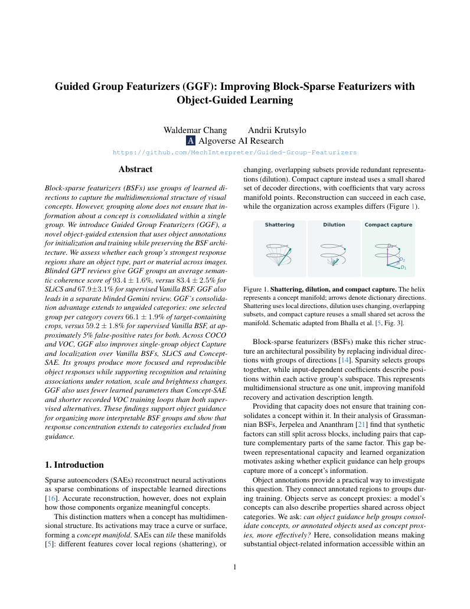

# Guided Group Featurizers: preprint

[Open or download the complete 50-page PDF](https://github.com/MechInterpreter/Guided-Group-Featurizers/raw/refs/heads/main/demo/public/paper.pdf)

The direct PDF link works independently of GitHub's file-preview renderer. The PDF contains selectable text, original-resolution figures, and the full supplementary material.

